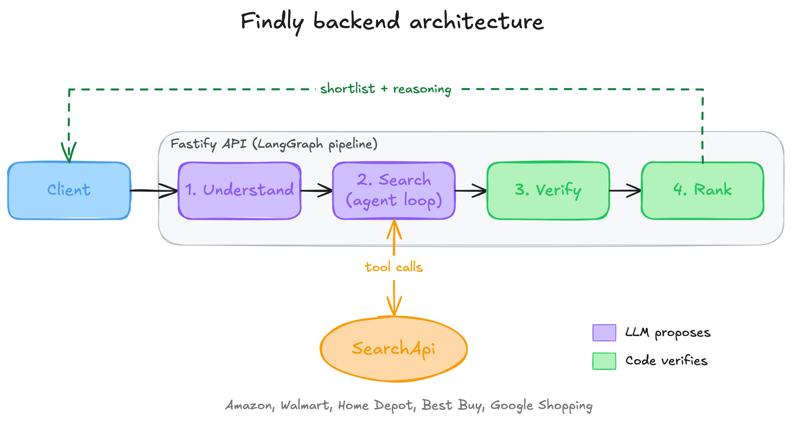
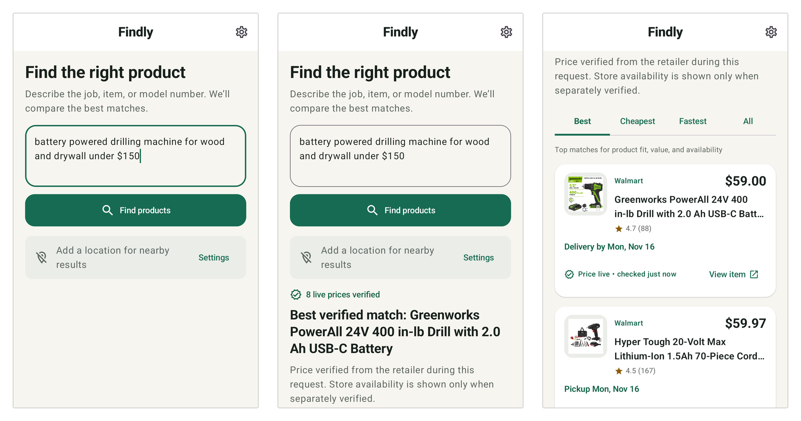

We are living in an era where most of the products are available for purchase at a click of a button. Even then buying something as simple as a cordless drill usually means opening multiple apps to compare prices across retailers such as Amazon, Walmart, Best Buy etc. I found myself spending several minutes comparing prices, delivery speed, availability across multiple apps and websites before finalizing which platform suits my needs the best. Moreover, often while shopping for home products, i can only describe the use or function (eg. screws for mounting microwave) of the item, but can't recall its actual name. The retail app searches usually don't work if you try to just. describe the function. I decided to build a simple app to solve this.

The app lets you type something like "a battery powered drilling machine for wood and drywall under \$150", and it searches multiple stores live and tells you where to buy. An LLM is great at understanding that sentence, but it has no idea what any store sells today or at what price. So I paired an agentic LLM loop with [SearchApi](https://www.searchapi.io/?utm_source=dev&utm_medium=ambassador&utm_campaign=maskaravivek.com), which gives the agent live results from different stores through one API.

In this article, I'll walk you through the key steps for building the backend layer for the agentic AI shopping assistant that uses Claude SDK and SearchApi to find the desired product along with its live prices across multiple retailer websites. The article covers how I call SearchApi, how I expose it to the LLM as tools, how I keep the model from making up products.

## Why to use SearchApi instead of scraping?

My first instinct was to write a scraper per retailer. Retail sites change their markup often, return different HTML per region, rate-limit aggressively and put bot checks in front of search pages. Morever, every new store would require another parser to maintain and another way for the app to break without telling you. So I decided to use SearchApi that offers a single endpoint to provide live search results across multiple retailers (ie. `engines`).

* [Google Shopping](https://www.searchapi.io/google-shopping?utm_source=dev&utm_medium=ambassador&utm_campaign=maskaravivek.com%20) for a price baseline across many merchants  
* [Amazon Search](https://www.searchapi.io/amazon?utm_source=dev&utm_medium=ambassador&utm_campaign=maskaravivek.com%20) which localizes with `amazon_domain` and `delivery_country`  
* [Walmart Search](https://www.searchapi.io/walmart-search-api?utm_source=dev&utm_medium=ambassador&utm_campaign=maskaravivek.com) for pickup, delivery dates and the seller name  
* [Home Depot Search](https://www.searchapi.io/home-depot-search-api?utm_source=dev&utm_medium=ambassador&utm_campaign=maskaravivek.com), which returns store pickup and stock when you pass a `store_id`  
* [BestBuy Search](https://www.searchapi.io/bestbuy-search-api?utm_source=dev&utm_medium=ambassador&utm_campaign=maskaravivek.com), which tells first-party and marketplace sellers apart

This immensely simplifies the agentic loop setup as the LLM agents receive a unified `tool`, structured JSON responses, live data for the user query, shared query parameters and one set of errors. For example, here's a trimmed `amazon_search` result for `q=cordless drill`:

```json
{
  "asin": "B00IJ0ALYS",
  "title": "DEWALT 20V MAX Cordless Drill and Impact Driver (DCK240C2)",
  "rating": 4.7,
  "reviews": 61409,
  "price": "$149.00",
  "extracted_price": 149,
  "fulfillment": {
    "standard_delivery": { "text": "Join Prime to get FREE delivery Tomorrow, Nov 13" },
    "fastest_delivery": { "text": "Or Non-members get FREE delivery Tue, Nov 17" }
  },
  "thumbnail": "https://m.media-amazon.com/images/I/81XPDrUh9sL._AC_UL320_.jpg"
}
```

In later sections, I will walk you through the process of integrating the SearchApi based retailer searches with an agentic LLM loop.

## Backend Architecture for Agentic Shopping

For this application, I decided to build a Node.js/Typescript service with [Fastify](https://fastify.dev/), and use [LangGraph.js](https://docs.langchain.com/oss/javascript/langgraph/overview) for the agentic loop. The backend use [Claude SDK](https://code.claude.com/docs/en/agent-sdk/overview) for LLM calls, and SearchApi REST APIs for live searches. The diagram below illustrates the high level backend architecture.



As shown in the diagram above, each request goes through multiple stages:

1. **Understand:** The first step uses Claude SDK to turn the raw user input into a structured request containing category, required features, excluded brands, a price cap, country and currency.  
2. **Search:** The next step uses an agentic LLM loop to search the retailer websites to find the best matches. It picks the stores and writes the queries, and each tool call runs a **SearchApi** engine.  
3. **Verify:** This step checks the shortlist against some handcrafted rules such as price cap, excluded brands and stores, and exact model numbers.  
4. **Rank:** A plain ranking function orders the filtered results, and the API returns it with the agent's reasoning.

The rule I followed: **the LLM model proposes, and code (ie. handcrafted rules) verifies.** The LLM is good at turning "drilling machine" into "cordless drill driver kit" and at judging which listings fit. But it's difficult to trust it with prices, budgets or IDs, therefore we use SearchApi to fetch live data.

> Note: I used the Claude SDK (`@anthropic-ai/sdk`) for the agent, but you can do the same with OpenAI's function calling. Only the LLM model call changes. The SearchApi code and the tools stay the same.

## Implementing the Backend for Agentic AI Shopping assistant

You can find the [complete source code](https://github.com/maskaravivek/findly) for the backend application on Github including the deployment steps. In the following sub-sections, we will cover the key aspects of building the backend application. We will skip the scaffolding, and common setup steps to keep the tutorial focussed.

### Adding the SearchApi client

SearchApi provides a single API endpoint that you can use to query all the different retailers for live prices and availability.

```
https://www.SearchApi.io/api/v1/search
```

The API accepts an `engine` parameter that lets you set the desired retailer (eg. Amazon, BestBuy, Walmart etc.). To integrate SearchApi, add a `SearchApiClient` in your project with the following code snippet:

```ts
export const SearchApi_ENDPOINT = "https://www.SearchApi.io/api/v1/search";

export class SearchApiClient {
  private readonly cache = new Map<string, { expiresAt: number; value: Promise<unknown> }>();

  search(engine: string, params: SearchApiParams, options: { signal?: AbortSignal } = {}) {
    const key = SearchApiClient.cacheKey(engine, params), now = Date.now();
    const hit = this.cache.get(key);
    if (hit && hit.expiresAt > now) return hit.value;
    const value = this.request(engine, params, options.signal);
    this.cache.set(key, { expiresAt: now + this.options.cacheTtlMs, value });
    return value;
  }

  private async request(engine: string, params: SearchApiParams, signal?: AbortSignal) {
    const url = new URL(SearchApi_ENDPOINT);
    url.searchParams.set("engine", engine);
    for (const [key, value] of Object.entries(params))
      if (value !== undefined) url.searchParams.set(key, String(value));

    for (let attempt = 0; ; attempt++) {
      const response = await fetch(url, {
        headers: { Authorization: `Bearer ${this.options.apiKey}`, Accept: "application/json" },
        signal,
      });
      if (response.ok) return response.json();
      // Retry once on 429 and 5xx, honoring Retry-After
      if ((response.status === 429 || response.status >= 500) && attempt === 0) {
        await sleep(this.backoff(attempt, response.headers.get("retry-after")));
        continue;
      }
      throw new SearchApiError(response.status, httpMessage(response.status, engine));
    }
  }
}
```

Lets go over the code snippet and understand what it does:

* The `request` method calls the SearchApi REST API endpoint with the specified engine to fetch live search results. The method also handles retrial and errors gracefully.  
* The API key goes in the `Authorization` header instead of the query string, so it never ends up in logged URLs.  
* The cache stores the promise rather than the result, so if the agent fires two identical searches at the same time, they share one SearchApi request. I keep the TTL at 5 minutes (`SearchApi_CACHE_TTL_MS`) so repeat queries are cheap but prices don't go stale.

You can browse the complete code for the [SearchApiClient on Github](https://github.com/maskaravivek/findly/blob/0115ccbb191499fa7f3a623f67e5d007047fbb8c/apps/api/src/retailers/searchapi/client.ts).

### Defining Search Engine result handlers

The response structure for each search engine is slightly different. I didn't want the agent to deal with any of that, so I defined [engines](https://github.com/maskaravivek/findly/blob/0115ccbb191499fa7f3a623f67e5d007047fbb8c/apps/api/src/retailers/searchapi/engines.ts) for each of the retailers to simplify the result parsing. Each engine gets a small definition with two functions.

* `buildParams` that turns a generic search into SearchApi parameters  
* `toOffer` that turns one result into a common offer format.

For example, here's a code snippet that demonstrates the Amazon a trimmed version of the Amazon engine:

```ts
const AmazonItem = z.object({
  title: z.string().trim().min(1),
  extracted_price: z.number().positive(),
  asin: opt(idish), link: opt(text), rating: opt(numberish), reviews: opt(numberish),
  thumbnail: opt(text),
  fulfillment: opt(z.object({ standard_delivery: opt(delivery), fastest_delivery: opt(delivery) })),
});

const amazon: SearchApiEngineDefinition<z.infer<typeof AmazonItem>> = {
  engine: "amazon_search", retailerId: "amazon", resultsKey: "organic_results", itemSchema: AmazonItem,
  description: "Amazon marketplace in the shopper's country; broad catalog, first-party and third-party sellers, delivery estimates",

  buildParams(input, defaults) {
    const country = (input.country ?? defaults.country).toUpperCase();
    const domain = AMAZON_DOMAINS[country] ?? "amazon.com"; // amazon.ca, amazon.co.uk, ...
    return { domain, currency: amazonCurrency(domain), warnings: [], params: {
      q: input.query,
      amazon_domain: domain,
      delivery_country: country,
      price_max: input.maxPrice,
      sort_by: input.sortBy === "rating" ? "average_review" : input.sortBy,
    } };
  },

  toOffer(item, context) {
    return baseOffer("amazon", { ...item, id: item.asin }, context, 0.85, {
      url: amazonProductUrl(item.link, item.asin, context.domain), // stable /dp/<asin> link
      seller: { type: "unknown" },
      fulfillment: { shipping: true, delivery: true, pickup: false, inStore: false, status: "unknown",
                     estimate: amazonDeliveryEstimate(item.fulfillment) },
    });
  },
};
```

Notice that only title and `extracted_price` are required, so a missing field never drops a whole result. The description goes into the system prompt, so the agent knows what each store is good for.

A generic adapter runs any of the above engine definitions as shown in the code snippet below:

```ts
async searchProducts(input) {
  const { params, currency, domain } = this.definition.buildParams(input, this.defaults);
  const raw = await this.client.search(this.definition.engine, params);
  const observedAt = raw.search_metadata.created_at;

  return (raw[this.definition.resultsKey] ?? [])
    .map(item => this.definition.itemSchema.safeParse(item))
    .filter(parsed => parsed.success)
    .map(parsed => this.definition.toOffer(parsed.data, { observedAt, currency, domain }))
    .filter(offer => offer !== null);
}
```

Every offer now has the same shape no matter which store it came from, with an offerId like `walmart:17963807391`, a seller type, a price and the time SearchApi fetched it. Adding a sixth store means writing one more definition.

### Exposing SearchApi product search as an agent tool call

With every store returning the same offer shape, the next step is to let the agents actually search them. There are two parts to this: defining the tools the model can see, and handling each call in code.

#### Defining the tools

The agent can't call SearchApi directly. It only sees the tools I give it, and I give it three:

* **search\_products** searches one store through SearchApi. This is the only tool that costs anything, so each call counts against a search budget.  
* **get\_seen\_offers** lists every offer from earlier searches. It's free, so the agent can recall results without searching again.  
* **finalize\_shortlist** ends the task. The agent passes the IDs of its picks, best first, with a short reason.

Each tool is defined with a name, a description the model reads, and a JSON Schema for its input. Here's `search_products`:

```ts
{
  name: "search_products",
  description: "Search one retailer for current offers. Returns a compact list of offers with offerIds. Each call spends one unit of the search budget.",
  input_schema: {
    type: "object", additionalProperties: false, required: ["retailerId", "query"],
    properties: {
      retailerId: { type: "string", enum: retailers.map(r => r.id) },
      query: { type: "string", description: "Retailer search query, e.g. a product name, model number or short description." },
      maxPrice: { type: "number", description: "Optional price ceiling in major currency units (e.g. 199.99)." },
      sortBy: { type: "string", enum: ["relevance", "price_low_to_high", "price_high_to_low", "rating"] },
    },
  },
}
```

Note that `retailerId` is an enum built from the enabled engines, so the model can't invent a store. `maxPrice` and `sortBy` map to SearchApi's `price_max` and `sort_by` inside each engine's `buildParams`.

#### Handling a search call

When the agent calls search\_products, this handler runs. This is where the code takes over:

```ts
const searchProducts = async (raw: unknown) => {
  const parsed = SearchProductsInputSchema.safeParse(raw);
  if (!parsed.success) throw new ToolError("Invalid input: retailerId and a non-empty query are required.");
  if (searchesUsed >= budget.maxToolCalls) return BUDGET_SPENT;
  searchesUsed++;

  const result = await tools.searchProducts(parsed.data); // runs the SearchApi engine
  seen.add(result.offers);                                // remember every real offer
  return JSON.stringify({
    offers: compactView(result.offers),
    warnings: result.warnings,
    searchesLeft: budget.maxToolCalls - searchesUsed,
  });
};
```

Lets go over the above code snippet to understand its key aspects:

* Each request gets at most `AGENT_MAX_TOOL_CALLS` searches (12 by default). That helps in controlling latency and SearchApi usage no matter what the model decides to do.  
* Every offer returned goes into a `SeenOffers` map keyed by `offerId`. I check the final shortlist against this map later.  
* The model never sees the raw JSON. Each offer is cut down to an ID, store, seller, a short title, the price, rating, review count and a one-line delivery summary. That keeps around 50 offers from five stores small enough to fit comfortably in the context.

### The agent loop

Now that we have the SearchApi client and agent tools defined, we can implement the agentic loop using Claude SDK. The loop itself is short. The Claude SDK's tool runner sends the conversation, runs the tools the model asks for, sends back the results and repeats:

```ts
const runner = this.client.beta.messages.toolRunner({
  model: "claude-sonnet-5-5",
  max_tokens: 16_000,
  system: buildSystemPrompt(request, tools.retailers, budget),
  messages: [{ role: "user", content: buildUserMessage(request) }],
  tools: runnableTools,
  max_iterations: budget.maxToolCalls + 5,
}, { signal: AbortSignal.timeout(120_000) });

for await (const message of runner) {
  await runner.generateToolResponse(signal); // run this turn's tool calls
  if (finalized) break;                      // finalize_shortlist was called
}
```

The [system prompt](https://github.com/maskaravivek/findly/blob/main/apps/api/src/agent/shopping-agent.ts#L171) lists each store with its description and tells the model how to work. The core instructions in the system prompt is to:

1. Search Google Shopping first.  
2. Search the other stores in one turn.  
3. Prefer first-party sellers at a similar price.  
4. Finish with 4 to 8 offers it has actually seen.

### Reinforcing the model output using SearchApi data

LLMs can make up IDs. When the model calls `finalize_shortlist`, I keep only the IDs that actually came back from SearchApi:

```ts
export function validateShortlist(ids: string[], seen: SeenOffers) {
  const offers = [];
  let dropped = 0;
  for (const id of new Set(ids)) {
    const offer = seen.get(id);
    if (offer) offers.push(offer); else dropped++;
  }
  return { offers, dropped };
}
```

If none of the IDs are real, the tool returns an error and the model gets one more try. If it never finalizes, the ranking function picks from everything it found. Either way, every product in the response has a price and link from a real SearchApi result in that request.

Finally, I [apply the hard rules](https://github.com/maskaravivek/findly/blob/main/apps/api/src/products/verify-shortlist.ts) from the parsed request. Offers over the price cap, from excluded brands or stores, or not matching a requested model number get dropped, and the response includes a warning saying why.

### Defining the API routes

The graph sits behind a small Fastify service with three routes as shown below:

```ts
app.post("/v1/search", async (request, reply) => {
  const parsed = SearchRequestSchema.safeParse(request.body);
  if (!parsed.success) return reply.code(400).send({ error: "invalid_request", issues: parsed.error.issues });
  return service.start(parsed.data);
});
app.post("/v1/search/:requestId/clarification", /* resume with the shopper's answer */);
app.get("/v1/search/:requestId/events", /* SSE replay of progress and tool calls */);
```

You can find the [source code for the routes](https://github.com/maskaravivek/findly/blob/main/apps/api/src/routes/search.ts) on Github. Heres what each of the APIs do:

* `POST /v1/search` starts a search. It takes a text query and, optionally, country, currency, postalCode and maxPrice.  
* `POST /v1/search/:requestId/clarification` answers a follow-up question. If a request is too vague, like a drill bit with no material, the graph pauses and returns a question instead of offers. Sending the answer resumes the same LangGraph thread.  
* `GET /v1/search/:requestId/events` replays the request's progress as Server-Sent Events, with one event per tool call.

## Testing the backend

Now that we have the entire backend implemented, lets proceed to test it. If you don't have the code setup locally, clone the repo, add your keys and start the server:

```sh
git clone https://github.com/maskaravivek/findly.git
cd findly
cp .env.example .env   # set SearchApi_API_KEY and ANTHROPIC_API_KEY
pnpm install
pnpm dev
```

Note, you need two API keys. For SearchApi, sign up at [SearchApi.io](http://searchapi.io?utm_source=dev&utm_medium=ambassador&utm_campaign=maskaravivek.com) and copy the key from your dashboard. For Anthropic, create one in the [Anthropic Console](https://platform.claude.com/settings/keys) under API Keys.

Once the backend is running, send a search request:

```sh
curl -X POST http://localhost:3000/v1/search \
  -H 'content-type: application/json' \
  -d '{"text":"battery powered drilling machine for wood and drywall under $150","country":"US","imageIds":[]}'
```

It takes about 20 seconds. I usually look at `toolTrace` first, since it shows how the agent used SearchApi. In my run, it searched Google Shopping first, then the four stores, and then finalized:

```json
"toolTrace": [
  { "tool": "search_products", "input": { "retailerId": "google_shopping", "query": "cordless drill/driver kit", "maxPrice": 150 } },
  { "tool": "search_products", "input": { "retailerId": "amazon", "query": "20V cordless drill driver kit battery charger", "maxPrice": 150 } },
  ...
  { "tool": "finalize_shortlist", "resultSummary": "7 offers shortlisted" }
]
```

The model turned "drilling machine" into "cordless drill driver kit", worded the Amazon query the way Amazon titles read, and passed "under \$150" as `price_max` on every call. Each item in `offers` is built from a SearchApi result (trimmed):

```json
{
  "offerId": "walmart:17963807391",
  "seller": { "name": "Walmart.com", "type": "first_party" },
  "product": { "title": "Hyper Tough 12V Brushless Cordless 50-Piece Project Kit with 1.5Ah Battery & Charger", "rating": 4.7 },
  "price": { "total": { "amountMinor": 3997, "currency": "USD" } },
  "fulfillment": { "estimate": "Delivery by Fri, Nov 13" },
  "source": { "kind": "search_api", "observedAt": "2026-11-13T03:07:54.000Z" }
}
```

### Bonus: Trying it on Android

The repo also has a native [Android app](https://github.com/maskaravivek/findly/tree/main/apps/android) built on this API. You can build and run it to test the backend visually. I ran the same drill search on the Android emulator, with the app pointed at my local server.



To build it yourself, run `pnpm android:build` (you need JDK 17+ and Android SDK 35).

## Conclusion

In this article, we learned how to build an agentic AI based shopping assistant using Claude SDK and [SearchApi](https://www.searchapi.io/?utm_source=dev&utm_medium=ambassador&utm_campaign=maskaravivek.com). SearchApi REST APIs, immensely simplified the backend implementation as we got live, structured results from multiple retailers through one endpoint without building and maintaining any scrapers. To make the backend intelligent, dynamic and efficient, we use LLMs so that it can decide what to search before finalizing the results. In addition to LLMs, we still have static verification checks to control budget, clean up results, and filter out unwanted output.

There's plenty of room to extend it. You can add more SearchApi engines with one definition each, pass a `postalCode` or `store_id` to get local pickup and stock from Home Depot and Walmart, or swap Claude for OpenAI without touching the SearchApi code.

The [GitHub repo](https://github.com/maskaravivek/findly) also has a native Android app built on this API, so you can try it from your phone.
